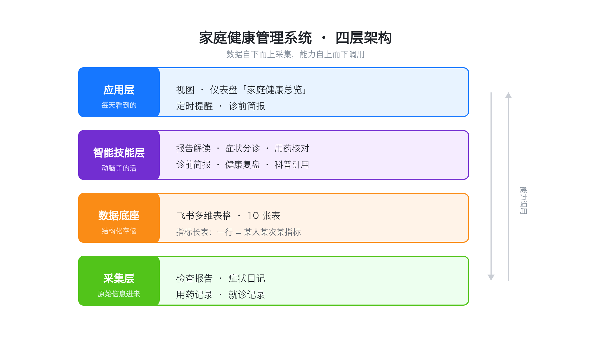
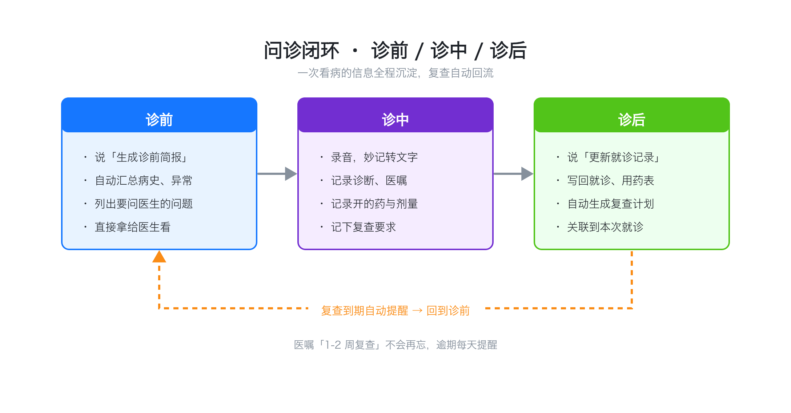

# 家庭健康管理系统（豆包 + 飞书）

用 **豆包** 当执行与推理入口、用 **飞书多维表格** 当健康资产底座、用 **默沙东诊疗手册大众版** 当权威科普来源，搭一套覆盖「日常—周期—长期」的家庭健康记录、解读、存档与提醒系统

让每一次看病都有准备、有记录、有跟进，让报告不再是看完就忘的一次性信息

---

## 为什么做

家里有老人孩子，带娃半夜看病、血常规满屏箭头看不懂、医生说"1 到 2 周复查"转头就忘、自己的过敏和体检指标多年散落、想看趋势得翻好几份报告

缺的不是一次问答，而是一套会自己记录、会盯复查、会主动提醒、还能陪你问诊的系统

于是把它从模糊想法做成了完整系统，并把**设计手册、表结构、技能提示词、使用手册**全部开源，方便照着重建

## 系统架构

数据自下而上采集，能力自上而下调用，一共四层：



- **采集层**：拍照、语音、一句话记录报告、症状、用药、就诊，不填表单
- **数据底座**：一个飞书多维表格（10 张表），结构化存储
- **智能技能层**：6 个技能负责解读、分诊、核对、复盘等"动脑子"的活
- **应用层**：视图、仪表盘、定时提醒、诊前简报，是每天真正看到的部分

## 内容分层

- **日常**：检查报告解读存档、症状日记、用药记录、过敏管理、关键指标关注
- **周期**：月度小结、复查提醒、疫苗接种、检查计划
- **长期**：年度体检、年度复盘、花粉季备药、家族病史、年度目标

## 问诊闭环

把一次看病拆成诊前、诊中、诊后三步，信息全程沉淀，复查自动回流：



- **诊前**：一句话生成「诊前简报」，自动汇总病史、异常、用药和要问医生的问题
- **诊中**：录音转文字，记录诊断、医嘱、开的药和复查要求
- **诊后**：自动写回就诊、用药表，并生成复查计划，到期主动提醒

## 6 个智能技能

| 技能 | 作用 |
|---|---|
| report-reader 报告解读 | 发报告，自动解读、标异常、存档 |
| symptom-triage 症状分诊 | 判断轻重缓急，识别危险信号，再记录 |
| medication-check 用药核对 | 核对相互作用、禁忌和重复用药 |
| visit-brief 诊前简报 | 就诊前自动汇总病史和要问的问题 |
| health-review 健康复盘 | 月度、年度健康复盘 |
| msd-reference 科普引用 | 结合默沙东大众版给出权威解释 |

## 目录结构

```
family-health-system/
├── README.md                     # 本文件
├── LICENSE                       # MIT
├── docs/
│   ├── 01-design-handbook.md     # 完整设计手册（架构/内容/施工依据）
│   ├── 02-table-schema.md        # 飞书 Base 10 张表完整字段
│   ├── 03-skills-prompts.md      # 6 大技能提示词库（可直接复制）
│   └── 04-user-manual.md         # 使用手册（日常怎么用）
├── diagrams/
│   ├── architecture.png          # 四层架构图
│   └── visit-loop.png            # 问诊闭环图
└── templates/
    └── feishu-base-schema.json   # 机器可读建表模板
```

## 快速开始

1. 新建一个飞书多维表格，照着 [`docs/02-table-schema.md`](docs/02-table-schema.md) 逐表建字段（机器可读版本见 [`templates/feishu-base-schema.json`](templates/feishu-base-schema.json)）
2. 关键设计：检验指标用**长表**，一行 = 某人某次某指标；表间关联用**单向关联**
3. 把 [`docs/03-skills-prompts.md`](docs/03-skills-prompts.md) 里的 6 个提示词，在豆包对话里直接使用，或固化到自定义技能/智能体
4. 按 [`docs/04-user-manual.md`](docs/04-user-manual.md) 建视图、仪表盘和定时提醒
5. 完整的设计与施工思路见 [`docs/01-design-handbook.md`](docs/01-design-handbook.md)

## 免责声明

本项目是健康**资料管理与就医辅助**工具，所有 AI 解读和科普内容均不能替代医生面诊或药师审核

如遇急症、重症或危险信号，请立即线下就医或拨打急救电话

## 致谢

- [默沙东诊疗手册大众版](http://www.msdmanuals.cn/home)：免费、权威、面向普通人的医学科普

## License

[MIT](LICENSE)
